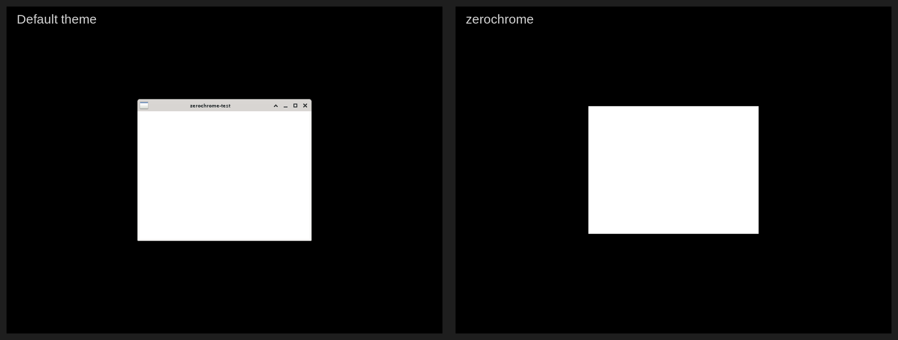

# zerochrome

A decorationless [xfwm4](https://docs.xfce.org/xfce/xfwm4/start) theme.

Windows managed by xfwm4 with this theme have **no title bar, no borders,
no corners, no buttons and no compositor shadows**. You see only the
application's own window content.



## How it works

xfwm4 computes the size of every decoration from the dimensions of the
PNG/XPM images in a theme. A theme that ships **no images at all** therefore
produces frame extents of `0, 0, 0, 0` — nothing is drawn around the client
window, and no space is reserved for it.

`zerochrome/xfwm4/` deliberately contains only `themerc`. The `themerc` keeps
the remaining theme options at zero and disables title text, buttons, extra
top border and compositor shadows so the result is predictable.

This is not a "1px invisible border" trick: the windows really do get zero
decoration extents.

## Install

```sh
./install.sh
```

This copies the theme to:

```
${XDG_DATA_HOME:-$HOME/.local/share}/themes/zerochrome
```

Then select **zerochrome** in `xfwm4-settings` (Settings → Window Manager),
or install and activate it in one step:

```sh
./install.sh --set
```

`--set` also forces a running xfwm4 to reload, even if zerochrome was already
the configured theme. If you are not running the Xfce settings daemon, restart
the window manager with:

```sh
xfwm4 --replace
```

### Manual install

```sh
mkdir -p ~/.local/share/themes
cp -R zerochrome ~/.local/share/themes/
xfconf-query -c xfwm4 -p /general/theme -s zerochrome
```

(`~/.themes` works too on most systems.)

## Living without decorations

There are no title-bar buttons, so use xfwm4's keyboard and mouse bindings:

| Action | Default binding |
| --- | --- |
| Window menu | `Alt` + `Space` |
| Move window | `Alt` + left-drag, or `Alt` + `F7` |
| Resize window | `Alt` + right-drag, or `Alt` + `F8` |
| Close window | `Alt` + `F4` |
| Maximize | `Alt` + `F10` |
| Hide/minimize | `Alt` + `F9` |
| Fullscreen | `Alt` + `F11` |
| Switch windows | `Alt` + `Tab` |

Because the frame has zero width, you cannot grab an edge with the mouse to
resize; use `Alt` + right-drag or `Alt` + `F8`. The same applies to moving:
drag the window body while holding `Alt`, or use `Alt` + `F7`.

## Notes and limitations

- This only controls decorations drawn by **xfwm4** (server-side decorations).
  GTK applications using client-side decorations (CSD) still draw their own
  header bars — that is application behaviour, not a window-manager theme.
- Shadows are disabled by the theme (`shadow_opacity=0`). If you want the
  compositor's drop shadows back, remove the `shadow_*` keys from
  `zerochrome/xfwm4/themerc`.
- If you ever want a 1px invisible border (so window edges can be grabbed to
  resize), add transparent 1×1 PNGs named after the decoration parts
  (`left-active.png`, `bottom-inactive.png`, `title-1-active.png`,
  `top-left-active.png`, etc.). Any image present restores that extent.
- The theme is intentionally image-free. Do not "fix" the missing images by
  adding files — their absence is the whole mechanism.
- Tested with xfwm4 4.20 (Xfce 4.20). The zero-extent mechanism has been part
  of the theme loader for many years, so older xfwm4 releases should behave
  the same.

## Uninstall

```sh
./uninstall.sh
```

This removes `${XDG_DATA_HOME:-$HOME/.local/share}/themes/zerochrome` and,
if zerochrome was the active theme, switches xfwm4 back to `Default`.

You can also remove it manually:

```sh
rm -rf "${XDG_DATA_HOME:-$HOME/.local/share}/themes/zerochrome"
```

Then pick another theme in `xfwm4-settings`.

## Verify

Ask X11 for the frame extents of a window managed by xfwm4:

```sh
xprop -id "$(xdotool getactivewindow)" _NET_FRAME_EXTENTS
# _NET_FRAME_EXTENTS(CARDINAL) = 0, 0, 0, 0
```

(`xdotool` is optional; any window id works.)

## License

MIT — see [LICENSE](LICENSE).
